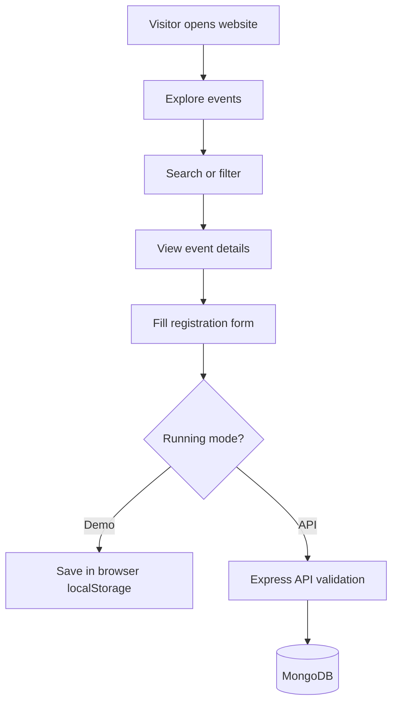

<div align="center">

# 🎭 MILAN 2026

### Where Creativity Meets Community

**A modern festival website experience built for discovering events, exploring activities, and registering interest.**

<p>
  
  
  
  
</p>

<p>
  <a href="#-overview">Overview</a> ·
  <a href="#-features">Features</a> ·
  <a href="#-quick-start">Quick Start</a> ·
  <a href="#-project-structure">Structure</a> ·
  <a href="#-deployment">Deployment</a>
</p>

---

**Discover • Celebrate • Connect**

</div>

## ✨ Overview

**MILAN 2026** is a full-stack festival website starter designed to present events in an engaging, responsive interface and support attendee registration workflows. It combines a **React + TypeScript + Vite** frontend with an optional **Express + MongoDB** API.

> [!IMPORTANT]
> This repository is a **project starter**, not an official festival announcement. Event dates, descriptions, awards, branding, and registration details in the sample dataset are placeholders until confirmed by organizers.

## 🚀 Features

<table>
  <tr>
    <td width="50%">
      <h3>🎨 Festival Landing Page</h3>
      <p>Responsive, festival-inspired layout designed for desktop and mobile screens.</p>
    </td>
    <td width="50%">
      <h3>🔎 Event Discovery</h3>
      <p>Browse event cards, search listings, and filter by category.</p>
    </td>
  </tr>
  <tr>
    <td>
      <h3>📅 Event Details</h3>
      <p>Open event detail views to explore the sample event information.</p>
    </td>
    <td>
      <h3>📝 Registration Form</h3>
      <p>Client-side form validation using Zod, with optional server-side submission.</p>
    </td>
  </tr>
  <tr>
    <td>
      <h3>🧪 Demo Mode</h3>
      <p>Try the interface without configuring a database; demo submissions stay in the browser.</p>
    </td>
    <td>
      <h3>🔐 API Foundation</h3>
      <p>Express routes, Mongoose models, validation, CORS configuration, and rate limiting.</p>
    </td>
  </tr>
</table>

## 🧰 Technology Stack

<div align="center">

| Layer | Technologies |
|:--|:--|
| **Frontend** | React, TypeScript, Vite, CSS |
| **Forms & validation** | Zod |
| **Backend** | Node.js, Express, TypeScript |
| **Database** | MongoDB, Mongoose |
| **API safeguards** | Helmet, CORS, rate limiting |
| **Testing** | Vitest (starter tests) |
| **Deployment configuration** | Vercel (frontend), Render / Docker (backend) |

</div>

## ⚡ Quick Start

### 1. Clone the repository

```bash
git clone https://github.com/YOUR_USERNAME/milan-fest-website.git
cd milan-fest-website
```

> Replace `YOUR_USERNAME` with your GitHub username and adjust the URL if your repository has a different name.

### 2. Install dependencies

Use **Node.js** and **npm**. From the repository root:

```bash
npm install
```

### 3. Start the frontend

```bash
npm run dev
```

Open the local URL displayed by Vite in your terminal.

### 4. Optional: Run the backend

Create the backend environment file:

```bash
# macOS / Linux
cp backend/.env.example backend/.env
```

```powershell
# Windows PowerShell
Copy-Item backend/.env.example backend/.env
```

Edit `backend/.env` to set your own MongoDB connection and any other required values, then start the API:

```bash
npm run dev:backend
```

> [!CAUTION]
> Never commit `.env` files, MongoDB credentials, API keys, or secrets to GitHub.

## ⚙️ Demo Mode vs API Mode

| | Demo mode | API mode |
|:--|:--|:--|
| Database required | ❌ No | ✅ Yes |
| Registration storage | Browser `localStorage` | MongoDB via backend |
| Intended use | UI demos and exploration | Backend-integrated development |
| Production-ready registration | ❌ No | ⚠️ Requires deployment, security review, and testing |

Demo mode is enabled by default in the starter. To use the API, configure the frontend environment with the appropriate values:

```dotenv
VITE_DEMO_MODE=false
VITE_API_URL=http://localhost:YOUR_BACKEND_PORT
```

Replace `YOUR_BACKEND_PORT` with the port configured for your backend. Restart the frontend after changing environment variables.

## 🗂️ Project Structure

```text
milan-fest-website/
├── frontend/                 # React + TypeScript + Vite application
│   ├── src/                  # UI, components, data, and tests
│   └── ...
├── backend/                  # Express + TypeScript + MongoDB API
│   ├── src/                  # Routes, models, validation, middleware
│   ├── .env.example          # Backend environment template
│   └── Dockerfile
├── docs/
│   └── IMPLEMENTATION-AND-SUBMISSION.md
├── package.json             # Workspace scripts
├── render.yaml              # Render deployment configuration
└── README.md
```

## 🧭 How It Works



## 🧪 Testing and Quality

The starter includes a small Vitest test setup. Run the scripts defined in the repository's `package.json` to check the project before publishing.

```bash
npm run build
```

> [!NOTE]
> A successful local build does not by itself verify database connectivity, email delivery, production deployment, or real-world registration flows.

## 🌍 Deployment

**Frontend:** Deploy the frontend application to Vercel or another static-site host. Configure the frontend project root and environment variables according to your hosting platform.

**Backend:** Deploy the Express service to Render or another Node.js host, set the MongoDB connection securely, and configure allowed frontend origins.

**Database:** Use a properly secured MongoDB instance with restricted credentials and suitable access controls.

Before opening registration to real attendees, confirm event details, privacy disclosures, validation, abuse protections, data retention, and operational monitoring.

## 🛣️ Roadmap

- [x] Responsive festival-themed interface starter
- [x] Sample event listings, search, and category filters
- [x] Event detail and registration modals
- [x] Demo-mode registration storage
- [x] Express and MongoDB backend foundation
- [ ] Replace placeholder events with organizer-approved information
- [ ] Complete end-to-end testing with a live database
- [ ] Add organizer/admin access with authentication and authorization
- [ ] Add secure attendee confirmation workflows
- [ ] Complete accessibility and security reviews
- [ ] Deploy and verify the production website

## 🤝 Contributing

Contributions are welcome. For substantial changes, open an issue describing the proposal before submitting a pull request. Keep changes focused and include tests when applicable.

## 📜 License

No license is asserted by this README. Add a `LICENSE` file only after choosing the terms under which you want to distribute the project.

## 📣 Acknowledgment

Built as a **MILAN 2026 festival website project**. Any official affiliation, festival schedule, registration process, and use of event branding must be verified with the organizers.

---

<div align="center">

### 🌟 Make every moment memorable.

**Made with React, TypeScript, and a passion for great web experiences.**

<sub>If you find this project useful, consider starring the repository ⭐</sub>

</div>
